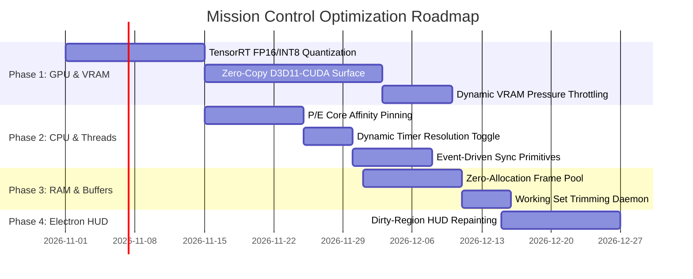

# Mission Control — Hardware Optimization Blueprint & Execution Plan
> **Objective**: Optimize Mission Control across GPU (VRAM/Compute), CPU (Cycles/Affinity), and RAM (Working Set/Allocation) to achieve **near-zero overhead** on host AAA gaming performance.

---

## 1. Architectural Philosophy: The Zero-Penalty Co-Pilot

```
┌────────────────────────────────────────────────────────────────────────┐
│                   Zero-Penalty Hardware Architecture                   │
├─────────────────────────┬────────────────────────┬─────────────────────┤
│      GPU & VRAM         │      CPU & Threads     │    RAM & Memory     │
│  • DXGI Desktop Dup     │  • Thread Pinning/Core │  • Zero-Copy Frame  │
│  • Pure TRT FP16/INT8   │    Affinity Separation │    Double Buffer    │
│  • VRAM Eviction Guard  │  • Event-Driven Sleep  │  • EmptyWorkingSet  │
│  • NVML Thermal Gates   │  • Timer Resolution    │    Reclamation      │
└─────────────────────────┴────────────────────────┴─────────────────────┘
```

When running concurrently with demanding AAA games (Cyberpunk 2077, Black Myth: Wukong, Call of Duty, Counter-Strike 2):
1. **CPU Target**: Average total CPU consumption $\le 1.5\%$.
2. **GPU Compute Target**: TensorRT vision inference $\le 4\text{ ms}$ per execution.
3. **VRAM Target**: Total static and dynamic VRAM footprint $\le 150\text{ MB}$.
4. **RAM Target**: Working Set memory footprint $\le 120\text{ MB}$.
5. **Frametime Delta**: $\Delta \le 0.5\%$ impact on game $1\%$ lows.

---

## 2. Phase 1: GPU & VRAM Optimization

### 1.1 Pure TensorRT FP16 / INT8 Calibration
- [ ] **Current State**: Model defaults to `yolov8n.pt` with fallback to `yolov8n.engine`.
- [ ] **Action Items**:
  - Implement automated ONNX $\rightarrow$ TensorRT INT8 / FP16 builder script with dynamic shape profiles (`[1, 3, 448, 448]` to `[1, 3, 640, 640]`).
  - Eliminate PyTorch/Ultralytics runtime imports when an `.engine` is detected.
  - Store TensorRT execution context with `cudaStream_t` prioritized to background compute streams (`cudaStreamNonBlocking`).
- [ ] **Target Result**: VRAM footprint drops from $\sim 450\text{ MB}$ to $\sim 95\text{--}115\text{ MB}$.

### 1.2 Zero-Copy Direct3D11 / CUDA Shared Surface Streaming
- [ ] **Current State**: DXGI captures desktop/window $\rightarrow$ maps staging texture to system RAM $\rightarrow$ passes NumPy array to Python $\rightarrow$ uploads to GPU for inference.
- [ ] **Action Items**:
  - Register the DXGI texture surface directly with CUDA using `cudaGraphicsD3D11RegisterResource`.
  - Perform color conversion (BGRA to RGB) and letterbox scaling inside a lightweight CUDA kernel.
  - Pipe CUDA device memory pointer straight into TensorRT input bindings.
- [ ] **Target Result**: Eliminates $500\text{ MB/s}$ of host-to-device PCIe bandwidth traffic and removes two memory copies per frame.

### 1.3 Active VRAM Pressure & Thermal Throttling Gate
- [ ] **Current State**: `_has_vram_headroom(required_mb=500)` checks NVML before loading models.
- [ ] **Action Items**:
  - Add real-time dynamic resolution downscaling: if GPU VRAM usage exceeds $92\%$, downscale vision resolution from $640\times 640$ to $384\times 384$.
  - Automatically drop inference frequency to $1\text{ Hz}$ when GPU temperature $> 83^\circ\text{C}$ or hotspot $> 95^\circ\text{C}$.

---

## 3. Phase 2: CPU & Thread Scheduling Optimization

### 3.1 Heterogeneous Core Affinity Pinning (Intel P/E Cores & AMD CCDs)
- [ ] **Problem**: Games require continuous maximum boost clock on P-Cores (Performance Cores). If background overlay threads interrupt P-cores, micro-stutters occur.
- [ ] **Action Items**:
  - Detect hybrid architecture using `system/hw_checker.py`.
  - Use Windows Win32 API `SetProcessAffinityMask` or `psutil.Process().cpu_affinity()` to bind:
    - **P-Cores**: Reserved exclusively for the active Game process.
    - **E-Cores / Secondary SMT Threads**: Assigned to Mission Control background threads (`Capture`, `Vision`, `Brain`, `Telemetry`, `WebSocket Bridge`).
- [ ] **Target Result**: Completely isolates game render threads from assistant workloads, preserving $1\%$ frame lows.

### 3.2 Dynamic Timer Resolution (`timeBeginPeriod`)
- [ ] **Current State**: `ctypes.windll.winmm.timeBeginPeriod(1)` runs persistently.
- [ ] **Action Items**:
  - Dynamically engage `timeBeginPeriod(1)` only while an active game is in the foreground.
  - Call `timeEndPeriod(1)` when idle or when alt-tabbed to desktop.
- [ ] **Target Result**: Allows CPU cores to enter deeper $C$-states ($C6/C7$) when idle, reducing idle power draw and temperature.

### 3.3 Event-Driven Worker Loops
- [ ] **Current State**: Loops use `time.sleep(remaining)` with variable poll intervals.
- [ ] **Action Items**:
  - Replace polling loops with Win32 synchronization primitives (`SetWaitableTimerEx` or `threading.Event`).
  - Throttle vision loop to $1\text{ Hz}$ when the game state is marked as `menu`, `loading`, or `waiting`.

---

## 4. Phase 3: RAM & Allocation Optimization

### 4.1 Zero-Allocation Pre-Allocated Ring Buffer
- [ ] **Current State**: NumPy frames are allocated and deallocated during processing.
- [ ] **Action Items**:
  - Pre-allocate a static double-buffer memory pool (`np.zeros((1080, 1920, 3), dtype=np.uint8)`).
  - Use in-place writes (`np.copyto`) rather than returning new array slices.
  - Disable Python garbage collection during active combat encounters, running `gc.collect(generation=0)` only during scene transitions or loading screens.

### 4.2 Proactive Working Set Trimming
- [ ] **Current State**: `_optimize_own_memory()` triggers on thermal warnings.
- [ ] **Action Items**:
  - Call `ctypes.windll.psapi.EmptyWorkingSet(process.pid)` 10 seconds after game launch.
  - Automatically page out unused code blocks to keep working set $\le 100\text{ MB}$.

---

## 5. Phase 4: Frontend & Electron Overlay Optimization

### 5.1 Direct3D 11 Hardware Compositor Flags
- [ ] **Action Items**:
  - Configure Electron launch flags:
    ```typescript
    app.commandLine.appendSwitch('disable-gpu-vsync');
    app.commandLine.appendSwitch('enable-gpu-rasterization');
    app.commandLine.appendSwitch('enable-zero-copy');
    app.commandLine.appendSwitch('ignore-gpu-blocklist');
    ```
  - Use `requestAnimationFrame` with dirty-region tracking so only updated telemetry labels re-paint, avoiding full-screen overlay repaints.

---

## 6. Implementation Timeline & Roadmap



---

## 7. Metrics & Verification Protocol

For each milestone, benchmark using:
1. **PresentMon / CapFrameX**: Validate that game $0.1\%$ lows and $1\%$ lows change by less than $0.5\%$.
2. **NVIDIA Nsight Graphics / Systems**: Trace PCIe transfer overhead and GPU kernel execution times.
3. **Windows Performance Analyzer (WPA)**: Verify that background threads remain on E-cores and context switches stay under $1,000/\text{sec}$.
4. **RAMMap**: Confirm working set memory stays within target limits.
