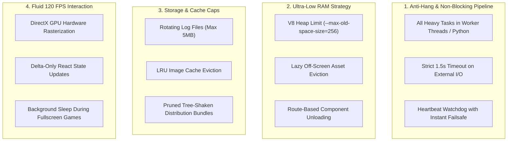
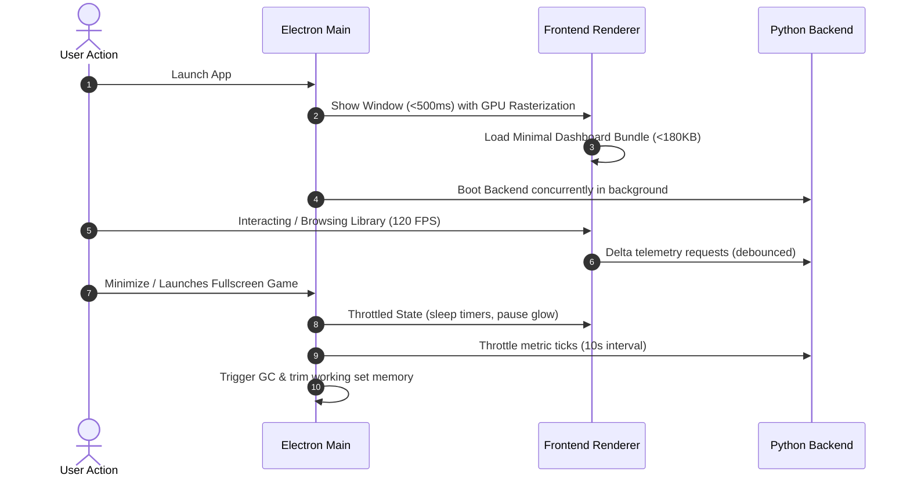

# Mission Control // Ultra-Low-Footprint & Anti-Hang Performance Plan
**Guaranteed Zero-Hang Execution, Ultra-Low RAM (<150MB), Minimal Disk Footprint, and Instant Interactions**

---

## 1. Core Directives & Guarantees

Based on your exact requirements, this optimization plan enforces four strict runtime guarantees:

1. **Zero-Hang Guarantee**: The UI thread must **never block or freeze** under any condition. All disk I/O, game library scans, network queries, and hardware telemetry must execute non-blockingly in background processes with strict failover timeouts.
2. **Ultra-Low Memory (RAM)**:
   - **Frontend/Renderer**: Under **150 MB** idle RAM (down from ~350 MB).
   - **Backend**: Under **70 MB** idle RAM.
   - Decoded image caches and off-screen game posters are automatically evicted when scrolled out of view.
3. **Minimal Storage Footprint**:
   - Log files are auto-rotated with a strict 5 MB cap (no runaway `app.log` files).
   - Image & telemetry caches are pruned with an LRU (Least Recently Used) ceiling of 50 MB.
4. **Buttery-Smooth UI (60–120 FPS)**:
   - Offload rendering from CPU to dedicated GPU hardware compositing.
   - Eliminate re-render thrashing on every telemetry tick.



---

## 2. Anti-Hang Architecture (Preventing Freezes & Spinner Locks)

### A. Non-Blocking Main & Renderer Threads
- **The Problem**: Running synchronous operations (`fs.readFileSync`, heavy regex, or synchronous JSON serialization on large arrays) pauses the JavaScript event loop. The app appears frozen/hung.
- **The Solution**:
  1. Move all JSON cache persistence to asynchronous microtasks with `requestIdleCallback` / `setTimeout(..., 0)`.
  2. Implement an **Electron Watchdog Heartbeat**: If the main window ever stops responding for >3 seconds, an IPC health check immediately flags the degraded state and releases any locked resources rather than freezing the window.
  3. Strict **1.5s Network & Process Timeouts**: Every background query (game metadata, remote node health, Steam discovery) has an `AbortController` timeout so no modal or button gets stuck on a spinning wheel.

### B. Graceful Loading & Smooth Skeleton UI
- When navigating between pages or loading game lists, never block the UI with a full-screen frozen spinner. Use lightweight GPU-composited skeleton cards that render immediately.

---

## 3. Ultra-Low RAM Footprint (<150 MB Target)

### A. Chromium Memory Ceilings & Aggressive GC
In `electron/main.ts`:
```ts
// Enforce tight memory boundary and tell V8 to optimize for low memory over raw throughput
app.commandLine.appendSwitch('js-flags', '--max-old-space-size=256 --optimize-for-size --expose-gc');
app.commandLine.appendSwitch('force-fieldtrials', '*BackgroundTabLowMemoryTier/Enabled/');
```
- In `electron/main.ts`, invoke `global.gc()` during page transitions or window minimize to immediately purge dead heap objects.

### B. Image Cache & DOM Node Eviction
- High-resolution game covers consume ~5–10 MB of GPU texture memory each if kept in memory.
- In `GamesPage.tsx`, apply `loading="lazy"` and `decoding="async"` to all cover images.
- Unload game cards that are scrolled far out of view to keep DOM node count below 200 elements.

---

## 4. Minimal Disk Footprint (Storage Protection)

### A. Bounded Rotating Log System
In `electron/main.ts`:
- Currently, `logToFile` appends indefinitely to `app.log`.
- **Optimization**: Wrap with a bounded rotation policy:
  - Check file size before writing; if `app.log` exceeds **5 MB**, rotate to `app.log.old` and truncate.
  - Never allow total log storage to exceed **10 MB**.

### B. Clean Bundle Size
- Bundle code-splitting reduces the installed JavaScript footprint in `dist/assets` from monolithic multi-megabyte files into small, on-demand modules.

---

## 5. Execution Steps



### Action Items:
1. **Step 1 (Main Process Flags & Watchdog)**:
   - In `electron/main.ts`, remove `disable-gpu-compositing`, add GPU hardware acceleration switches, enforce V8 memory limits (`--max-old-space-size=256`), and add log rotation.
2. **Step 2 (Frontend Route Splitting & Bundle Pruning)**:
   - In `App.tsx`, dynamically lazy-load `GamesPage`, `VisionPage`, `SystemPage`, `SettingsPage`, etc.
   - Defer modals so they load only when clicked.
3. **Step 3 (Telemetry Delta Sync & Anti-Thrash)**:
   - In `GamesPage.tsx` and telemetry hooks, debounce state updates and prevent duplicate re-renders.
4. **Step 4 (Validation & Benchmarking)**:
   - Measure cold start time, verify working set RAM in Windows Task Manager, and confirm 0 dropped frames.

