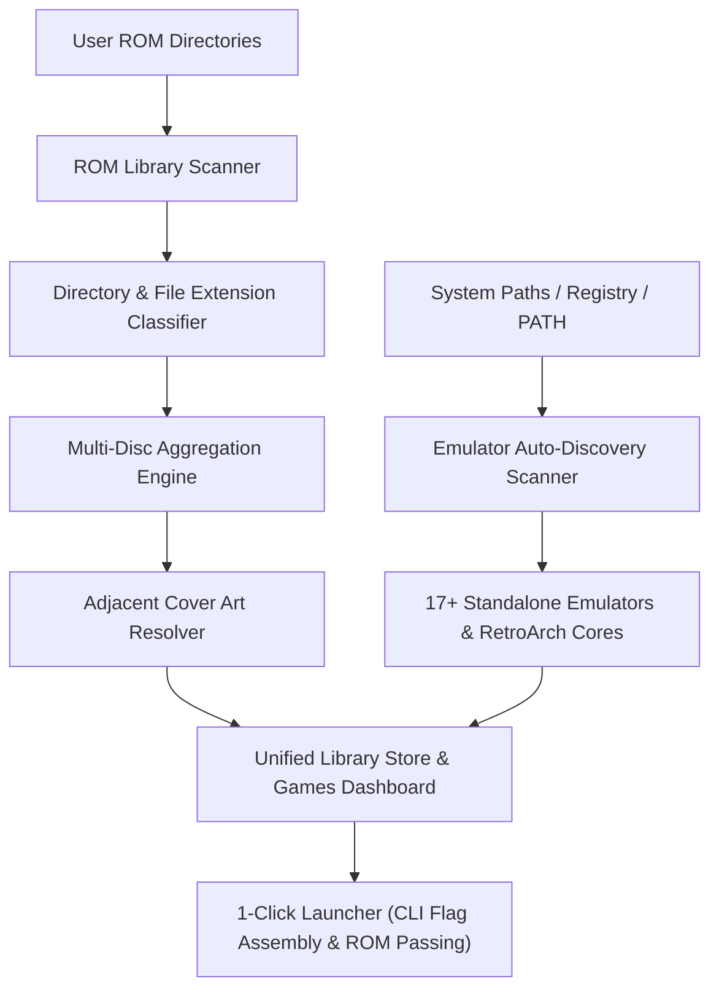
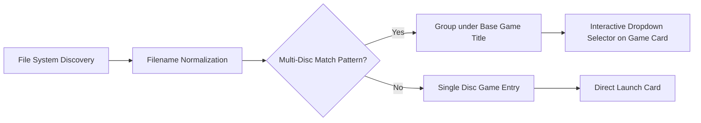

# 🕹️ Emulation & ROM Library Orchestration Engine

The **Mission Control Emulation Engine** unifies your physical console game backups and local emulators alongside modern PC storefronts (Steam, Epic Games, GOG, Xbox, EA, Ubisoft) within a single glassmorphic library interface.



---

## 🎯 Core Features

### 1. 🔍 Cross-Platform Auto-Discovery (17+ Emulators)
Mission Control automatically discovers standalone emulators and RetroArch installations across Windows and Linux:
- **PlayStation Family:** RPCS3 (PS3), PCSX2 (PS2), DuckStation (PS1), Vita3K (PS Vita), PPSSPP (PSP).
- **Nintendo Ecosystem:** Ryujinx (Switch), Dolphin (GameCube & Wii), Cemu (Wii U), Lime3DS & Citra (3DS), melonDS (NDS), mGBA (GBA), Snes9x (SNES), Mupen64Plus (N64).
- **Xbox Consoles:** Xenia & Xenia Canary (Xbox 360), Xemu (Original Xbox).
- **Sega & Multi-System:** Flycast (Dreamcast), RetroArch (scans all installed `libretro` core `.dll` and `.so` modules).

> [!NOTE]
> Custom executable paths and manual binary overrides can be set directly in the **Emulators & ROMs Hub** or via `Gaming/backend/config/emulator_overrides.json`.

---

## 📋 Supported Emulators & System Matrix

| Console | Primary Emulator | Fallback / Core | Common File Extensions | Windows Default Discovery Paths | Linux Default Paths |
| :--- | :--- | :--- | :--- | :--- | :--- |
| **PlayStation 3** | RPCS3 | — | `.pkg`, `.iso`, `EBOOT.BIN` | `%LOCALAPPDATA%\RPCS3`, `C:\RPCS3`, `D:\RPCS3` | `~/.var/app/net.rpcs3.RPCS3`, `/usr/bin/rpcs3` |
| **PlayStation 2** | PCSX2 | RetroArch (`pcsx2`) | `.iso`, `.chd`, `.bin`, `.cue`, `.gz` | `%LOCALAPPDATA%\PCSX2`, `C:\PCSX2`, `Program Files` | `~/.var/app/net.pcsx2.PCSX2`, `/usr/bin/pcsx2` |
| **PlayStation 1** | DuckStation | RetroArch (`beetle_psx_hw`) | `.chd`, `.cue`, `.iso`, `.pbp`, `.bin` | `%LOCALAPPDATA%\DuckStation`, `C:\DuckStation` | `~/.var/app/org.duckstation.DuckStation` |
| **PS Vita** | Vita3K | — | `.vpk`, `.zip`, `.pkg` | `%APPDATA%\Vita3K`, `C:\Vita3K` | `~/.var/app/org.vita3k.Vita3K` |
| **PSP** | PPSSPP | RetroArch (`ppsspp`) | `.iso`, `.cso`, `.chd`, `.pbp` | `%PROGRAMFILES%\PPSSPP`, `%APPDATA%\PPSSPP` | `/usr/bin/PPSSPPSDL`, `org.ppsspp.PPSSPP` |
| **Nintendo Switch** | Ryujinx | — | `.nsp`, `.xci` | `%APPDATA%\Ryujinx`, `C:\Ryujinx` | `~/.config/Ryujinx`, Flatpak |
| **GameCube & Wii** | Dolphin | RetroArch (`dolphin`) | `.iso`, `.rvz`, `.wbfs`, `.gcm`, `.ciso` | `%APPDATA%\Dolphin Emulator`, `C:\Dolphin` | `~/.var/app/org.DolphinEmu.dolphin-emu` |
| **Nintendo Wii U** | Cemu | — | `.wux`, `.wua`, `.rpx` | `%LOCALAPPDATA%\Cemu`, `C:\Cemu` | `~/.var/app/info.cemu.Cemu` |
| **Nintendo 3DS** | Lime3DS / Citra | RetroArch (`citra`) | `.3ds`, `.cia`, `.cxi` | `%LOCALAPPDATA%\Lime3DS`, `%APPDATA%\Citra` | `~/.var/app/io.github.lime3ds.Lime3DS` |
| **Nintendo DS** | melonDS | RetroArch (`melonds`) | `.nds`, `.bin` | `%APPDATA%\melonDS`, `C:\melonDS` | `/usr/bin/melonds`, Flatpak |
| **Game Boy Advance** | mGBA | RetroArch (`mgba`) | `.gba`, `.bin`, `.zip` | `%PROGRAMFILES%\mGBA`, `C:\mGBA` | `/usr/bin/mgba`, Flatpak |
| **Super Nintendo** | Snes9x | RetroArch (`snes9x`) | `.sfc`, `.smc`, `.zip` | `C:\Snes9x`, `D:\Snes9x` | `/usr/bin/snes9x-gtk` |
| **Nintendo 64** | Mupen64Plus | RetroArch (`mupen64plus_next`) | `.z64`, `.n64`, `.v64`, `.zip` | `C:\Mupen64Plus`, `%PROGRAMFILES%` | `/usr/bin/mupen64plus` |
| **Xbox 360** | Xenia | Xenia Canary | `.iso`, `.xex` | `C:\Xenia`, `%LOCALAPPDATA%\Xenia` | `/usr/bin/xenia` |
| **Original Xbox** | Xemu | — | `.iso`, `.xbe` | `%APPDATA%\xemu`, `C:\Xemu` | `~/.var/app/app.xemu.xemu` |
| **Dreamcast** | Flycast | RetroArch (`flycast`) | `.cdi`, `.gdi`, `.chd` | `C:\Flycast`, `%APPDATA%\Flycast` | `/usr/bin/flycast` |

---

## 💿 Multi-Disc Aggregation Engine

Classic role-playing games and adventure titles frequently span multiple disc images (`Disc 1`, `Disc 2`, `CD1`, `CD2`). Mission Control features an automated multi-disc grouping algorithm that prevents library clutter:



### Pattern Matching Heuristics
The engine matches expressions conforming to:
- `(Disc 1)`, `(Disc 2)`, `[Disc 1]`, `[Disc 2]`
- `(CD 1)`, `(CD 2)`, `(CD1)`, `(CD2)`
- `(Disk 1)`, `(Disk 2)`
- `_disc1`, `_disc2`, `-disc1`, `-disc2`

When detected, Mission Control creates a single card in your Game Intelligence dashboard with an interactive disc selector dropdown (`Disc 1`, `Disc 2`, etc.), allowing you to choose which disc to boot into the emulator on the fly.

---

## 🎨 Local Cover Artwork Resolution

The scanner checks for local boxart and poster images using high-priority adjacent lookups before falling back to external sources:
1. `<game_folder>/<rom_stem>.png` or `<rom_stem>.jpg`
2. `<game_folder>/<rom_stem>-cover.jpg`
3. `<game_folder>/<base_title>.png`
4. `<game_folder>/media/boxart/<rom_stem>.png`
5. `<game_folder>/covers/<rom_stem>.jpg`
6. Cloud Steam Header or generative SVG aesthetic placeholders.

---

## 🚀 Execution & Command Routing

When launching an emulated title, Mission Control bypasses basic shell execution in favor of an argument-aware subprocess dispatcher:

```python
# GameHandler Launch Flow
if game.get("is_emulated"):
    exe_path = game.get("exe_path")
    args = payload.get("args") or [payload.get("rom_path")]
    subprocess.Popen([exe_path] + [str(a) for a in args])
```

- **RPCS3:** Spawns binary with `--no-gui` (optional) and direct boot path to `.pkg` or `EBOOT.BIN`.
- **Ryujinx:** Launches with `-g <rom_path>` in fullscreen mode.
- **PCSX2:** Boots target `.iso` or `.chd` with fast-boot flags.
- **RetroArch:** Resolves the appropriate `.dll` or `.so` core dynamically and passes `-L <core_path> <rom_path>`.

---

## 🎛️ Emulators & ROMs Hub Interface

Access the hub at any time from the **Game Intelligence** toolbar:
- **Installed Tab:** Quick status of detected local emulators, paths, and instant test-launch buttons. In zero-emulator states, provides direct navigation buttons to explore the supported matrix or configure ROM folders.
- **All Emulators Tab:** Comprehensive matrix of all 17 supported emulators, supported consoles, official websites, and binary path override fields.
- **ROM Folders Tab:** Add and remove custom scan paths (e.g. `D:\Emulation\Roms` or `/mnt/games/roms`) and trigger immediate re-indexing with the **Scan ROMs Now** button.

---

## 🛡️ Smart Empty-State Redirection & Multi-User Session Isolation (v3.9.0)

### 1. Smart Scanner Redirection & Directory Validation
- When initiating a ROM scan with zero configured directories, Mission Control proactively transitions to the **ROM Folders** tab and surfaces a high-visibility warning banner:
  > *"No ROM Directories Configured — Please add at least one folder path below where your console ROMs or disc images (.iso, .chd, .pkg, etc.) are stored before scanning."*
- If the user filters the Game Intelligence library by `EMULATION` when no console titles are detected, a specialized empty-state card appears offering a 1-click shortcut to launch the **Emulators & ROMs Hub**.

### 2. Multi-Tenant Authenticated Session Library Merging
- Previous releases defaulted unauthenticated ROM scan operations to local `guest` session storage.
- In v3.9.0, scan requests pass the authenticated `userId` directly through Electron IPC to `handle_scan_roms`, ensuring discovered games are seamlessly merged into the active user's cloud-synchronized library session (`library_session[user_id]`) alongside local guest fallbacks.

